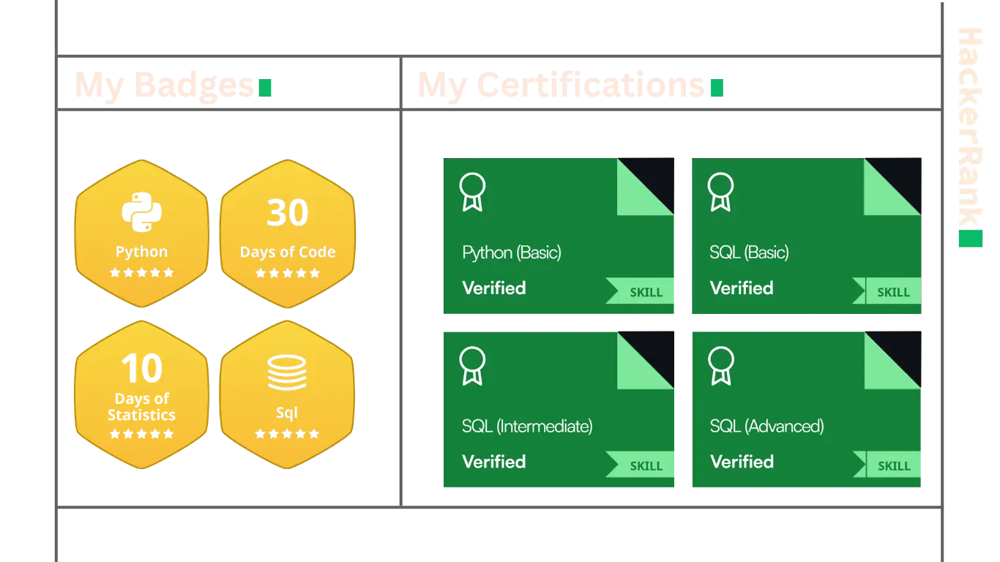

### Hey!

👾 I'm **Arkaprava Bhattacharya**.

🦀 Aspiring Software Engineer & ML Enthusiast.

- I'm a second-year CSE student and aspiring software developer. I'm building my portfolio website, AB-Space, with React to showcase my projects and exploring machine learning for space research. I'm also expanding my skills in Java, OOP, and finance, aiming to apply them in the space industry. I love collaborating on open-source projects and dreaming of the next giant leap for mankind.


[](https://github.com/ellerbrock/open-source-badge/)

```cpp
#include <iostream>
#include <cmath>
#include <chrono>
#include <thread>

constexpr double rocketDeltaV(double m0, double mf, double Isp, double g0 = 9.81) {
    return Isp * g0 * std::log(m0 / mf);
}

int main() {
    constexpr double initialMass = 500000;
    constexpr double finalMass   = 100000; 
    constexpr double specificImpulse = 300; 

    constexpr double deltaV = rocketDeltaV(initialMass, finalMass, specificImpulse);

    std::cout << "Arkaprava Bhattacharya\n"
              << "Aspiring Space Engineer & ML Enthusiast\n\n"
              << "Calculated Δv: " << deltaV << " m/s\n\n";


    for (int i = 3; i >= 0; --i) {
        std::cout << "T-minus " << i << "...\n";
        std::this_thread::sleep_for(std::chrono::milliseconds(500));
    }
    std::cout << "Liftoff! \n";

    return 0;
}

```


## 🚀 Skills

<p align="center">
  
</p>


## 🔧 Tech Stack

| Domain | Tools & Technologies |
|---|---|
| **Frontend** | React, Vite |
| **Backend** | Firebase |
| **Languages** | JavaScript, Python, Java, C++, C |
| **Tools** | VS Code, Android Studio, Git |
## 🏆 GitHub Trophies  
[](https://github.com/ryo-ma/github-profile-trophy)

## 📊 GitHub Stats  
[](https://git.io/streak-stats)

---  
✨ _Feel free to explore my repositories and connect with me!_

